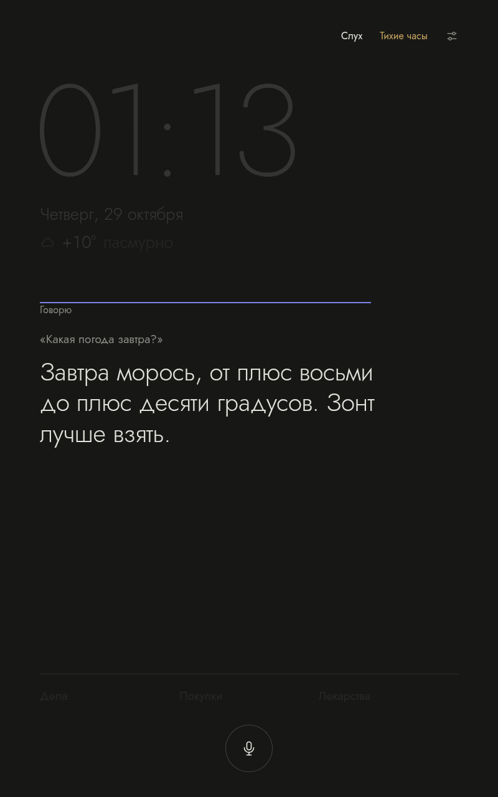
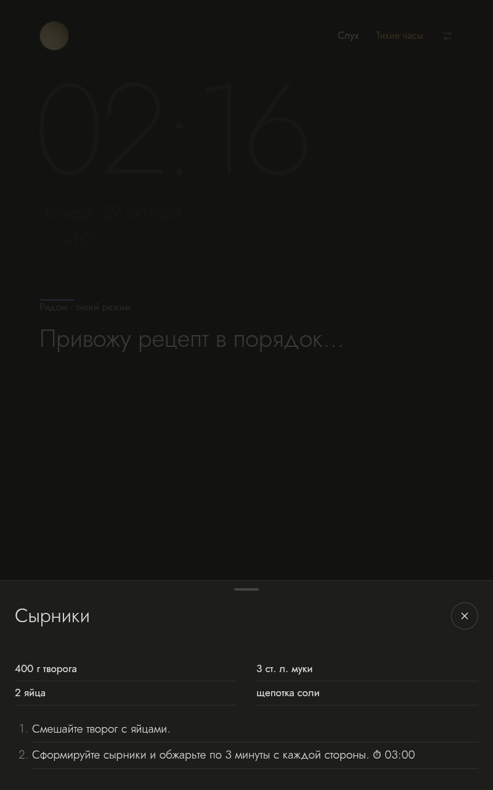
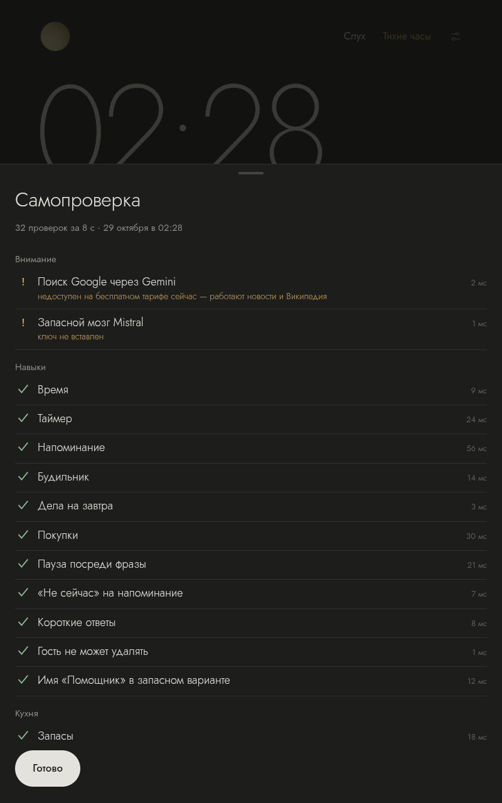

# Home Assistant "Pomoshnik"

**English** | [Русский](README.ru.md)

A voice assistant for a home Android tablet. It listens to the room, sees through the front camera, recognises family members and answers out loud. It keeps tasks, reminders, a shopping list, medication schedules, a kitchen pantry and recipes. It runs on Google's free Gemini AI, and the basics (timers, alarms, reminders, lists, weather) work without it.

> The assistant speaks and understands **Russian**. Its interface and voice commands are in Russian; this documentation gives each command with an English translation.

  
  
  
  

## Features

- 🗣 **Hands-free voice control.** Responds to its name ("Помощник, …"), follows up on the conversation, waits out pauses mid-sentence, and speaks with a natural Gemini voice.
- ⏰ **Timers, alarms and reminders**, with repeats by day and personal reminders for each family member.
- 🛒 **Shopping list** by voice, sent to your phone on request.
- 💊 **Medications**: schedules, dose reminders, missed-dose alerts, low-stock tracking. It never prescribes or changes doses.
- 🥕 **Kitchen**: what's at home, use-by dates, "what can I cook from what we have".
- 🍲 **Recipes**: search on 1000.menu, hands-free steps with timers, serving scaling, your own recipes by dictation.
- 👨‍👩‍👧 **Family**: on-device face recognition, greetings by name, a guest mode that hides personal information.
- 🌦 **Weather, exchange rates, news, general questions**, internet radio.
- 📱 **Phone link via Telegram**: shopping list, reminders when nobody is home, missed medications.
- 🆘 **SOS**: "Помогите!" ("Help!") or "Мне плохо" ("I feel unwell") sends an alarm to your phone.
- 🔁 **Reliability**: starts on boot, restarts after a crash, 32-point self-test.

Full list with voice commands: **[docs/features.md](docs/features.md)**.

## Quick install

1. Download `Pomoshnik-1.0-release.apk` from **[Releases](../../releases/latest)** onto a tablet running **Android 8.0+**.
2. Open the file, allow installs from this source, then tap **Install**.
3. Launch "Помощник" and allow **camera** and **microphone** access.
4. Get a free key at **aistudio.google.com → Get API key** and paste it into Settings (gear icon, top right).
5. Enter your **city**, then tap **Save** («Сохранить»).
6. Say **«Помощник, давай познакомимся»** ("let's get acquainted"), then **«Помощник, проверь себя»** ("check yourself").

Step by step, with autostart, Telegram and troubleshooting: **[docs/install.md](docs/install.md)**.

## Documentation

| Section | Contents |
|---|---|
| [Installation and first run](docs/install.md) | Requirements, installing the APK, keys, meeting the family, autostart, Telegram, updates, troubleshooting |
| [Features and voice commands](docs/features.md) | Everything the assistant does, with example phrases; what works without AI |
| [Settings](docs/settings.md) | Every setting and its default value |
| [Privacy](docs/privacy.md) | What is stored on the tablet, what goes online and where, how to delete it |
| [Building from source](docs/build.md) | Project layout, building the APK, running in a browser |

## Requirements

- Android 8.0 or newer. Developed on a Lenovo Tab M10 HD (Android 11); works in portrait and landscape.
- Front camera, microphone, Wi-Fi.
- A free Google Gemini API key (optional: the basic features work without it).

## Privacy in short

The APK and this repository contain **no personal data and no keys**. Everything you enter is stored only on the tablet. Faces are recognised on the device and never leave it. Your phrase and, when needed, a camera frame are sent to Google Gemini to get an answer. Details: [docs/privacy.md](docs/privacy.md).

## Important

The assistant is not a substitute for a doctor, a panic button or emergency services. It cannot place calls. In an emergency, call **112** (or your local emergency number).

## Third-party components

[face-api.js](https://github.com/vladmandic/face-api) © Vladimir Mandic, MIT License (`приложение/vendor/face-api.LICENSE.txt`).
