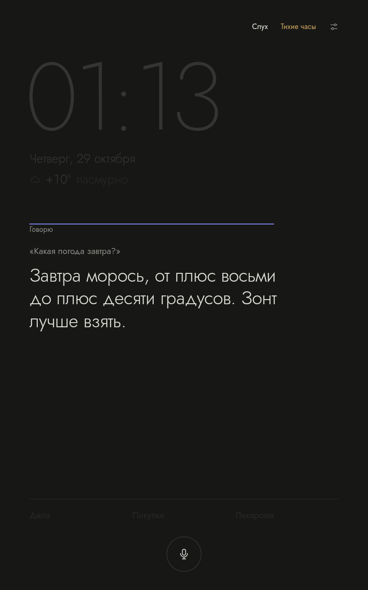
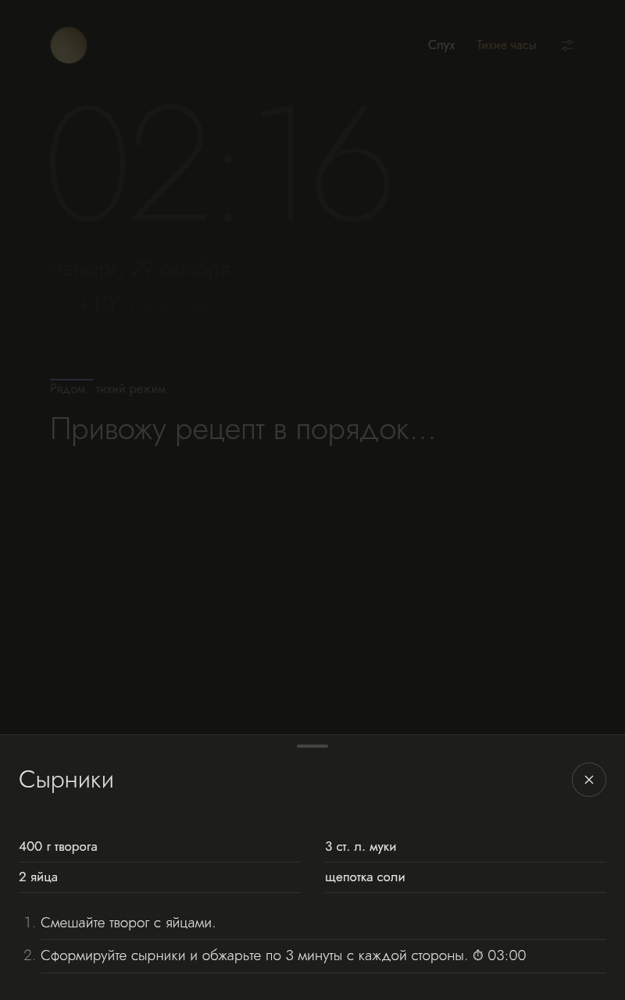
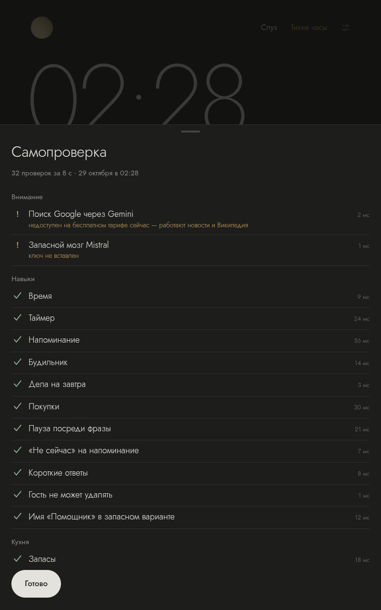

# Домашний помощник
[English](README.md) | **Русский**

Голосовой помощник для домашнего планшета на Android. Он слышит комнату, видит через камеру, узнаёт членов семьи и отвечает голосом. Ведёт дела, напоминания, покупки, лекарства, продукты на кухне и рецепты. Работает на бесплатном ИИ Google Gemini, а базовые вещи (таймеры, будильники, напоминания, списки, погоду) делает и без него.

  
  
  
  

## Возможности

- 🗣 **Голосом, без рук**: отзывается на имя («Помощник, …»), понимает продолжение разговора и паузы посреди фразы, говорит живым голосом Gemini.
- ⏰ **Таймеры, будильники, напоминания**, повторы по дням, личные напоминания для каждого члена семьи.
- 🛒 **Покупки**: голосом в список, отправка списка на телефон.
- 💊 **Лекарства**: расписание, напоминания о приёме, сигнал о пропуске, контроль запаса таблеток. Дозы помощник никогда не назначает.
- 🥕 **Кухня**: что есть дома, сроки годности, «что приготовить из того, что есть».
- 🍲 **Рецепты**: поиск на 1000.menu, шаги без рук с таймерами, пересчёт порций, свои рецепты под диктовку.
- 👨‍👩‍👧 **Семья**: узнаёт лица прямо на планшете, здоровается по имени, режим гостя прячет личное.
- 🌦 **Погода, курсы валют, новости, ответы на вопросы**, интернет-радио.
- 📱 **Связь с телефоном через Telegram**: список покупок, напоминания, когда дома никого нет, пропущенные лекарства.
- 🆘 **SOS**: «Помогите!», «Мне плохо» — сигнал тревоги на телефон.
- 🔁 **Надёжность**: автозапуск, перезапуск после сбоя, самопроверка из 32 пунктов.

Полный список с голосовыми командами: **[docs/ru/features.md](docs/ru/features.md)**.

## Быстрая установка

1. Скачайте `Pomoshnik-1.0-release.apk` со страницы **[Releases](../../releases/latest)** на планшет с **Android 8.0+**.
2. Откройте файл и разрешите установку из этого источника → **Установить**.
3. Запустите «Помощник» и разрешите доступ к **камере** и **микрофону**.
4. Получите бесплатный ключ на **aistudio.google.com → Get API key** и вставьте его в настройках (значок вверху справа).
5. Укажите **город** → **Сохранить**.
6. Скажите: **«Помощник, давай познакомимся»**, затем **«Помощник, проверь себя»**.

Подробно, с автозапуском, Telegram и решением проблем: **[docs/ru/install.md](docs/ru/install.md)**.

## Документация

| Раздел | О чём |
|---|---|
| [Установка и первый запуск](docs/ru/install.md) | Требования, установка APK, ключи, знакомство с семьёй, автозапуск, Telegram, обновление, частые проблемы |
| [Функции и голосовые команды](docs/ru/features.md) | Всё, что умеет помощник, с примерами фраз; что работает без ИИ |
| [Настройки](docs/ru/settings.md) | Каждый пункт настроек и значения по умолчанию |
| [Приватность](docs/ru/privacy.md) | Что хранится на планшете, что и куда уходит в интернет, как удалить |
| [Сборка из исходников](docs/ru/build.md) | Структура проекта, сборка APK, запуск в браузере |

## Требования

- Android 8.0 или новее; разработано на Lenovo Tab M10 HD (Android 11), работает в портретной и альбомной ориентации.
- Фронтальная камера, микрофон, Wi-Fi.
- Бесплатный ключ Google Gemini (необязательно: без него работают базовые функции).

## Приватность коротко

В APK и в репозитории **нет личных данных и ключей**: всё, что вы вводите, хранится только на планшете. Лица распознаются на устройстве и в интернет не уходят. Фраза и, когда нужно, кадр с камеры отправляются в Google Gemini для ответа. Подробно: [docs/ru/privacy.md](docs/ru/privacy.md).

## Важно

Помощник не заменяет врача, тревожную кнопку или экстренные службы. Сам он никуда не звонит. В экстренной ситуации звоните **112**.

## Сторонние компоненты

[face-api.js](https://github.com/vladmandic/face-api) © Vladimir Mandic, лицензия MIT (`приложение/vendor/face-api.LICENSE.txt`).
