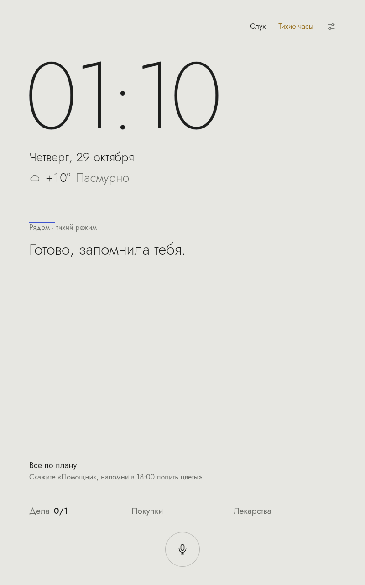
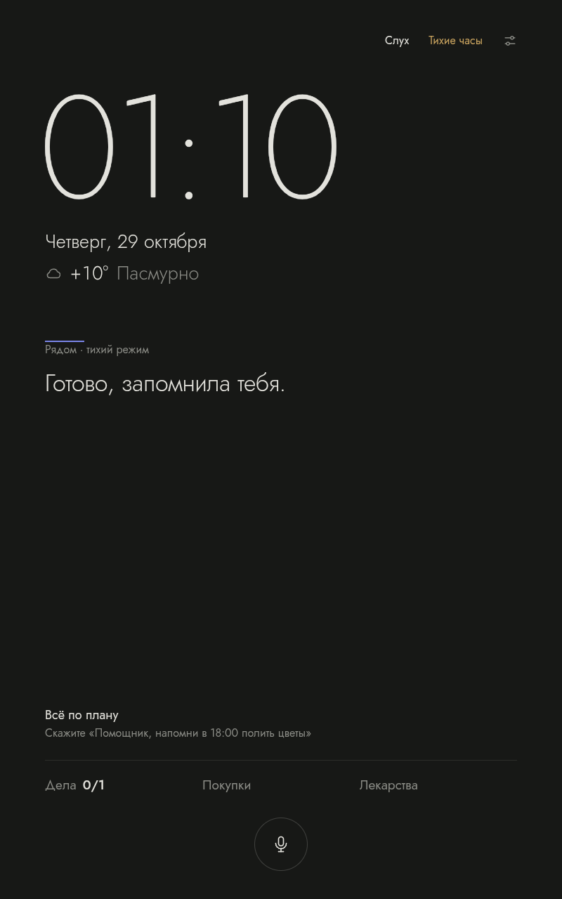
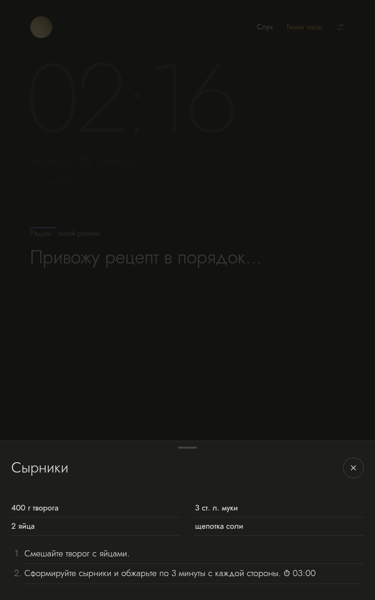
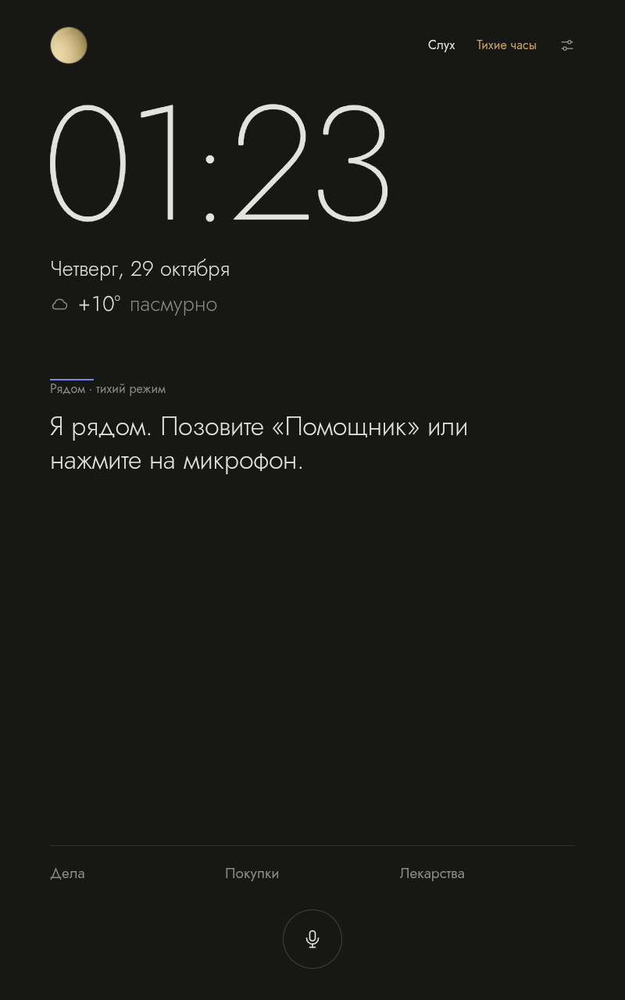

# Features and voice commands

[← Overview](../README.md) · [Installation](install.md) · [Settings](settings.md) · [Privacy](privacy.md) · [Build](build.md) · [Русский](ru/features.md)

The assistant speaks and understands **Russian**. Each command below is given in Russian, as you say it, with an English translation.

It responds to its name (default **«Помощник»**, "Assistant"; you can change it in Settings). Ways to talk to it:

- **Name + request**: «Помощник, поставь таймер на 5 минут» ("Assistant, set a 5-minute timer") — done right away.
- **Name only**: «Помощник» — it beeps and listens for the next phrase.
- **Microphone button** at the bottom of the screen — for one phrase.
- **Follow-up**: for 12 seconds after an answer (25 seconds after the assistant asks a question) you can speak without the name: «а завтра?» ("and tomorrow?"), «нет, в семь» ("no, at seven").

Icons in the tables:

| Icon | Meaning |
|---|---|
| 🟢 | Works **without an AI key**, right on the tablet |
| 🔵 | Needs a Gemini key (or a backup brain) |

The phrases are examples. The assistant understands similar wording too.

---

## Screen

| | |
|---|---|
|  |  |
| Light theme in the daytime | Dark theme after sunset |

- **Top bar**: «Слух» (Hearing — room listening on/off), «Тихие часы» / «Тихо» (Quiet — silence for 1 hour), Settings.
- **Clock, date, weather.** Tap the weather to hear the forecast.
- **Stage**: what the assistant heard and what it answered, with word-by-word captions.
- **«Сейчас»** (Now): the next medication, an overdue or upcoming reminder, a hint.
- **Widgets** «Дела» (Tasks), «Покупки» (Shopping), «Лекарства» (Medications), «Кухня» (Kitchen) open the lists, where you can tick off and delete items.
- **Bottom buttons**: «Посмотри» (Look — show the AI what the camera sees), microphone, «Дело» (Task — add a task by hand).
- **Camera window** in the corner shows that the camera is watching. Its border turns amber when only a stranger is present.
- **Idle screen**: a large clock and weather when nobody has touched the tablet for 3 minutes. Dimmed at night; the content shifts slightly to prevent burn-in.
- **Two looks**: «Минимализм» (Minimal, default; switches automatically at sunrise and sunset) and «Студия» (Studio; dark, with an animated "core").
- Tapping the stage while the assistant is speaking or ringing stops it.

---

## Time and date 🟢

| Say | Result |
|---|---|
| «Который час», «Сколько времени» (What time is it) | Tells the time |
| «Какое сегодня число», «Какой сегодня день» (What's the date / What day is it) | Tells the date |

---

## Timers 🟢

| Say | Result |
|---|---|
| «Поставь таймер на 5 минут» (Set a timer for 5 minutes), «Засеки полчаса» (Time half an hour), «Заведи 30 секунд» (30 seconds), «Засеки полтора часа» (an hour and a half) | Starts a timer (up to 24 hours; several can run at once) |
| «Сколько осталось», «Что с таймером» (How much is left) | Tells the time remaining |
| «Отмени таймер», «Сбрось все таймеры» (Cancel the timer / all timers) | Stops it |
| «Ещё 5 минут» (5 more minutes, while ringing) | Extends it |
| 🔵 «Поставь таймер на десять минут на пасту» (10-minute timer for the pasta) | Named timer |

When done, it rings for up to a minute and says «Время вышло: …» ("Time's up: …"). Say anything or tap the screen to stop it.

---

## Alarms 🟢

| Say |
|---|
| «Разбуди меня в 7» (Wake me at 7) |
| «Поставь будильник на 6:30 по будням» (Alarm at 6:30 on weekdays) |
| «Заведи будильник на завтра в 7 утра» (Alarm for 7 a.m. tomorrow) |
| «Будильник каждый понедельник в 8» (Alarm every Monday at 8) |

Alarms ring **even during quiet hours** and even if nobody is nearby: up to 3 minutes, with «Доброе утро! Пора вставать. Скажите «стоп» или «ещё 10 минут»» ("Good morning! Time to get up. Say 'stop' or '10 more minutes'").

- **Snooze**: «Ещё 10 минут» (10 more minutes), «Отложи» (Snooze), «Через 5» (In 5). Without a number it snoozes for 10 minutes.
- If the tablet was off and the alarm time passed more than 30 minutes ago, it doesn't ring.

---

## Tasks and reminders

| Say | Result |
|---|---|
| 🟢 «Напомни завтра в 9 позвонить маме» (Remind me tomorrow at 9 to call Mum) | |
| 🟢 «Напомни через 20 минут выключить духовку» (Remind me in 20 minutes to turn off the oven) | |
| 🟢 «Не дай мне забыть купить подарок в пятницу» (Don't let me forget to buy a present on Friday) | |
| 🟢 «Напомни каждый день в 8 вечера полить цветы» (Remind me every day at 8 p.m. to water the plants) | |
| 🟢 «Что у меня на завтра», «Какие дела на сегодня» (What do I have tomorrow / today) | Reads the plan |
| 🟢 «Не сейчас», «Позже», «Отложи» (Not now / Later, after a reminder) | Postpones by 30 minutes |
| 🔵 «Я всё, позвонила врачу» (Done, I called the doctor) | Marks the task done |
| 🔵 «Перенеси врача на четверг» (Move the doctor to Thursday), «Удали дело про посылку» (Delete the parcel task) | Edits or deletes |
| 🔵 «Напомни Пете в 5 забрать брата» (Remind Petya at 5 to pick up his brother) | Personal reminder for a family member |
| 🔵 «Спланируй мне день» (Plan my day) | Makes a plan |
| 🔵 «До среды допишу главу» (I'll finish the chapter by Wednesday) | Records a promise and asks how it went on the due date |

**Time expressions understood:** today, tomorrow, the day after tomorrow, weekdays, "in N minutes / an hour / half an hour", "at 9:30", "by 8 p.m.", «утром» (morning, 9:00), «днём» (afternoon, 13:00), «вечером» (evening, 19:00), «перед сном» (before bed, 22:00). Repeats: every day, weekdays, weekends, every Wednesday. "At 8" said in the afternoon means 20:00.

**How it reminds you:**

- Out loud, up to 3 times 15 minutes apart, but only when someone is nearby and it isn't quiet hours.
- A **personal reminder** is spoken only when the assistant sees that person. If others are present, it only says there's a personal reminder and to say «покажи» ("show") to see it on screen.
- With a **guest** (only a stranger present), reminders aren't read out.
- If nobody has been home for 10 minutes, the reminder goes to Telegram (if linked).
- If a task has been postponed 3 times, the assistant offers to split it up or drop it.

To add a task by hand: the **«Дело»** (Task) button at the bottom (text, time, day, «Повторять каждый день» — repeat daily).

---

## Shopping

| Say | Result |
|---|---|
| 🟢 «Добавь в покупки молоко, хлеб и яйца» (Add milk, bread and eggs to shopping), «Надо купить сыр» (Need to buy cheese), «Купи кофе» (Buy coffee) | Adds them (duplicates are skipped) |
| 🟢 «Что надо купить», «Прочитай список покупок» (What do we need / Read the shopping list) | Reads the list |
| 🔵 «Купила молоко» (I bought milk), «Очисти купленное» (Clear bought items) | Ticks off or clears |
| 🔵 «Отправь список на телефон» (Send the list to my phone) | Sends it to Telegram (or the «На телефон» button in the list) |

Food you tick off as bought moves to the Kitchen automatically; household items and medicines don't.

---

## Medications

| Say | Result |
|---|---|
| 🔵 «Записывай: аспирин по 100 мг каждый день утром после еды» (Write down: aspirin 100 mg every morning after food) | Adds a course |
| 🟢 «Выпила аспирин» (I took the aspirin), «Я уже приняла таблетки» (I've taken my pills), «Готово» (Done, after a reminder) | Marks the dose as taken |
| 🟢 «Пропущу», «Сегодня не буду» (I'll skip it / Not today) | Marks it as skipped |
| 🟢 «Позже», «Через полчаса» (Later / In half an hour) | Reminds again later (15 minutes by default) |
| 🔵 «Что мне сегодня принимать» (What do I take today), «Больше не пью витамин D» (I've stopped vitamin D) | Today's list, ends a course |

To add by hand: «Лекарства» tab → **«+ Лекарство»** (+ Medication). Fields: name, dose, times, repeat, before / with / after food, for whom, tablets in stock, course length.

- **Reminder**: «Пора принять аспирин 100 мг, после еды. Скажите «готово», когда примете» ("Time to take aspirin 100 mg, after food. Say 'done' when you've taken it"). Up to 3 times, 10 minutes apart.
- **Missed dose**: if a dose isn't marked within 30 minutes (configurable), a Telegram message is sent.
- **Stock**: when about 3 days of tablets are left, the medication is added to the shopping list.
- **Safety**: the assistant **never prescribes or changes doses**. For questions about dosage, side effects or interactions it suggests asking a doctor or pharmacist. If life is at risk, it tells you to call 112.

---

## Kitchen and food

| Say | Result |
|---|---|
| 🟢 «Что есть в холодильнике», «Какие у нас продукты» (What's in the fridge / What food do we have) | Reads the pantry |
| 🟢 «Что скоро испортится», «Что надо съесть в первую очередь» (What will spoil soon / What to eat first) | Use-by dates |
| 🟢 «Закончилось молоко», «Нет больше хлеба» (We're out of milk / No more bread) | Removes it from the pantry and adds it to shopping |
| 🔵 «Положила в холодильник курицу, годна до пятницы» (Put chicken in the fridge, good until Friday) | Adds it with place and date |
| 🔵 «Всегда держи дома два литра молока» (Always keep two litres of milk at home) | Minimum stock: adds to shopping when it runs low |
| 🔵 «Что приготовить из того, что есть» (What can I cook from what we have) | Suggests 1–2 dishes, starting with what spoils first |
| 🔵 «Посмотри в холодильник» (Look in the fridge, shown to the camera) | Lists what it sees and offers to add it |

The assistant guesses the place itself (fridge, freezer, cupboard); the AI estimates use-by dates. Once a day, between 9:00 and 20:00, it mentions what should be eaten soon or is past its date.

---

## Recipes

### From the internet 🟢

| Say | Result |
|---|---|
| «Найди рецепт борща» (Find a borscht recipe), «Как приготовить плов» (How to cook plov), «Давай приготовим сырники» (Let's make syrniki) | Finds the best-rated recipe on 1000.menu |
| «Дальше», «Назад», «Повтори», «Какой шаг» (Next / Back / Repeat / Which step) | Hands-free steps |
| «Какие ингредиенты» (What are the ingredients) | Reads the list |
| «На 4 порции», «На двоих» (For 4 servings / For two) | Rescales quantities |
| «Другой рецепт», «Не тот» (Another recipe / Not that one) | Shows another option |
| «Добавь недостающее в покупки» (Add what's missing to shopping) | Missing items go to the shopping list |
| «Сохрани» (Save) | Saves to the recipe book (up to 60) |
| «Мои рецепты», «Книга рецептов», «Открой рецепт …» (My recipes / Recipe book / Open recipe …) | Saved recipes |

Cooking times in the steps ("simmer for 40 minutes") are detected automatically and get a timer button. If the site has nothing, the AI writes a recipe 🔵.

### Your own recipes by voice 🟢

Say **«Запиши мой рецепт»** ("Record my recipe"). The assistant asks in turn for the name, ingredients, steps and number of servings, reads it all back and asks «Сохранить?» ("Save?").

- During dictation: «всё» (that's all), «убери последнее» (remove the last one), «повтори» (repeat), «пауза» (pause), «отмена» (cancel). To continue later: «продолжим рецепт» (let's continue the recipe).
- 🔵 All in one go: «Запиши рецепт: …» ("Record a recipe: …"); the AI splits it into ingredients and steps.
- Editing an open recipe: «добавь шаг …» (add a step), «убери ингредиент …» (remove an ingredient), «исправь шаг 2: …» (fix step 2), «переименуй в …» (rename to), «удали этот рецепт» (delete this recipe).

---

## Weather, exchange rates, news, questions

| Say | Result |
|---|---|
| 🟢 «Какая погода», «Погода завтра», «Что с погодой послезавтра» (What's the weather / tomorrow / the day after) | Forecast with umbrella advice (city must be set in Settings) |
| 🟢 «Курс евро» (Euro rate), «Сколько стоит доллар в злотых» (How much is a dollar in zloty) | Rates from the National Bank of Poland (for zloty) or open.er-api |
| 🔵 «Что нового в новостях» (What's in the news), «Кто такой …» (Who is …), any question | Google Search via Gemini; if unavailable, Google News and Wikipedia |
| 🔵 «Сколько будет 17 на 23» (What's 17 times 23), «Как по-английски …» (How do you say … in English) | Answered by the AI |

Currencies: EUR, USD, PLN, RUB, UAH, GBP, CHF, CZK, BYN, KZT, JPY, CNY, TRY.

---

## Radio

| Say | Result |
|---|---|
| 🟢 «Включи музыку», «Включи радио» (Play music / Turn on the radio) | Last genre, or Russian pop |
| 🟢 «Громче», «Тише», «Другая станция», «Выключи музыку» (Louder / Quieter / Another station / Turn off the music) | Controls |
| 🔵 «Включи джаз» (Play jazz), «Включи что-нибудь спокойное» (Play something calm), «Радио Рекорд» (Radio Record) | By genre or station |

Stations come from the open Radio Browser directory. The music gets quieter while the assistant listens or speaks. **It can't play specific songs or artists**, only radio.

---

## Family and face recognition

| Say | Result |
|---|---|
| 🟢 «Давай познакомимся» (Let's get acquainted), «Запомни меня» (Remember me), «Познакомься с моим сыном Петей» (Meet my son Petya) | Acquaintance |
| 🟢 «Забудь меня» (Forget me) | Deletes that person (after confirmation) |

- Faces are recognised **on the tablet** and never go online.
- It greets a known person once a day: «Добрый день, Маша! У вас сегодня 2 дела» ("Good afternoon, Masha! You have 2 tasks today").
- It takes into account formal or informal address («ты» / «вы»), age (it speaks more simply with children) and mood from facial expression.
- **Guest mode.** When only a stranger is present, the assistant:
  - doesn't read out tasks, medications or the morning briefing;
  - doesn't talk about the family;
  - doesn't allow deleting tasks, clearing lists or erasing memory;
  - hides personal items in the lists.

Family management: Settings → «Семья» (Family): retake a face, delete someone, add a person.

---

## Memory 🔵

| Say | Result |
|---|---|
| «Запомни: я пью кофе без сахара» (Remember: I take coffee without sugar) | Saves a fact (up to 80) |
| «Забудь про кофе» (Forget about the coffee) | Deletes it |

The assistant **refuses to remember** passwords and card or document numbers. You can review and delete facts in Settings → «Память» (Memory).

---

## On its own 🔵

- **Morning briefing**: the first person who comes by between 6:00 and 12:00 gets the day's plan and weather in 2–3 sentences, once a day.
- **Camera hints**: it speaks up by itself only when it's useful (cooking, danger, someone leaving). How often depends on «Разговорчивость» (Talkativeness): Quiet — at most once every 60 minutes, Normal — 20, Active — 7.
- **Quiet hours** and «Помолчи» ("be quiet", 1 hour): it won't start talking by itself, but alarms still ring.

---

## Emergency (SOS) 🟢

Works **at any time, even without the name**: «Помогите» (Help), «На помощь» (Help!), «Мне плохо» (I feel unwell), «Вызови скорую» (Call an ambulance), «Я упал» (I've fallen), «Не могу встать» (I can't get up), «Задыхаюсь» (I can't breathe), «Сердце болит» (My heart hurts).

- **Telegram linked**: the assistant stops the radio and sounds and says it will send an alarm to the phone and to say «отмена» (cancel) if everything is fine. After 20 seconds a 🆘 message with the phrase it heard and the last camera observation goes to the phone. Cancel with «отмена» (cancel), «всё хорошо» (all good), «случайно» (by accident).
- **Telegram not linked**: it tells you to call 112 if you need an ambulance.

> The assistant **does not call** emergency services itself. It is not a replacement for a panic button or a medical alert bracelet.

---

## Phone link (Telegram)

Setup is described in [install.md](install.md#10-phone-link-via-telegram-optional).

| Message the bot | Reply |
|---|---|
| 🟢 `список`, `покупки` (list, shopping) | Shopping list |
| 🟢 `дела`, `план` (tasks, plan) | Tasks for today and tomorrow |
| 🟢 `лекарства`, `таблетки` (medications, pills) | Today's doses |
| 🔵 Any text: «добавь молоко» (add milk), «напомни в 19:00 забрать посылку» (remind me at 19:00 to collect the parcel) | Done; the reply comes to the chat and the tablet stays silent |

The assistant sends by itself: the shopping list (on request), reminders when nobody is home, missed medications and SOS alerts.

---

## Voice and speech control 🟢

| Say | Result |
|---|---|
| «Стоп», «Хватит», «Подожди», «Понятно» (Stop / Enough / Wait / Got it) | Stops talking |
| «Помолчи», «Не мешай» (Be quiet / Don't disturb) | Silent for 1 hour |
| «Подробнее», «Да» / «Нет, спасибо» (More / Yes / No, thanks) | Continue or stop a long answer (long answers are shortened, then it asks «Рассказать подробнее?» — "Tell you more?") |
| «Смени голос», «Другой голос» → «Оставь» (Change voice / Another voice → Keep it) | Picks the tablet's voice |
| «Проверь себя», «Покажи последнюю проверку» (Check yourself / Show the last check) | Self-test |

**Voice.** "Live Gemini voice" with 6 timbres, female and male. If its limit runs out, the tablet's own voice is used. The assistant uses grammatical gender matching its voice.

**Pauses.** If you stop to think mid-sentence («напомни завтра в… э-э… девять» — "remind me tomorrow at… um… nine"), it waits for you to finish.

---

## What works without an AI key

Timers, alarms, reminders (simple phrases), today's and tomorrow's tasks, the shopping list, weather, exchange rates, recipe search on 1000.menu and recipe dictation, the kitchen (what's there, what will spoil, what's run out), marking medications, radio with fixed phrases, SOS, Telegram commands, and the self-test (except the AI network checks).

For anything else it says «Сначала добавьте ключ Gemini в настройках» ("Add a Gemini key in Settings first"). When the daily limit is used up, it says it can still do timers, alarms, reminders, shopping, tasks and weather without AI.

---

## What the assistant can't do

- Play specific songs or videos.
- Make phone calls.
- Control lights or appliances.
- Order goods.
- Message anyone other than the linked phone.

It says so honestly and, where possible, offers an alternative (such as the radio).

---

## Reliability

- Restarts after a crash and starts when the tablet is turned on ([how to enable](install.md#9-autostart-and-restart-after-a-crash)).
- If the page freezes for 90 seconds, the app reloads it.
- At 4:00 a.m., if nothing is going on, the page quietly reloads.
- **Self-test**: 32 checks (skills, kitchen, medications, recipes, network, camera, microphone, voice, screen) on test data. Your data isn't changed. Runs on the command «Проверь себя» and by itself after every update.
