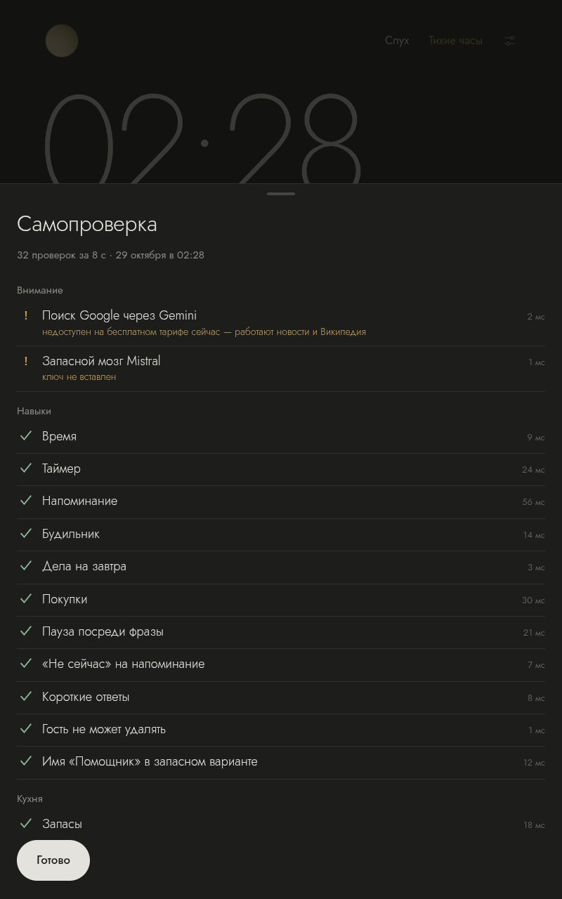

# Installation and first run

[← Overview](../README.md) · [Features](features.md) · [Settings](settings.md) · [Privacy](privacy.md) · [Build](build.md) · [Русский](ru/install.md)

The app's interface is in Russian. Labels are given as they appear on screen, with an English translation in brackets.

---

## 1. Requirements

| | Requirement |
|---|---|
| Device | Tablet or phone with **Android 8.0 or newer**. Developed and tested on a Lenovo Tab M10 HD (Android 11) |
| Camera | Front camera. The app runs without one, but then it cannot recognise people, tell whether someone is nearby, or give camera-based hints |
| Microphone | Required for voice control |
| Speech recognition | Google speech recognition service on the device (usually preinstalled) |
| Voice | A Russian text-to-speech voice on the device (Settings → Accessibility → Text-to-speech) |
| Internet | Wi-Fi. Offline, only timers, alarms, reminders and lists work |
| AI key | A free Google Gemini API key. Without it the assistant only handles basic commands ([which ones](features.md#what-works-without-an-ai-key)) |

Storage: about 15 MB for the app plus its data.

---

## 2. Download the APK

On the tablet, open this repository's **Releases** page and download `Pomoshnik-1.0-release.apk`.

You can also download it on a computer and copy it to the tablet over USB.

---

## 3. Allow installing from a file

By default Android only installs apps from Google Play. The permission is granted to the one app you open the APK with (your browser or "Files").

1. Open the downloaded `Pomoshnik-1.0-release.apk`.
2. Android says installation from this source is blocked. Tap **Settings**.
3. Turn on **Allow from this source**.
4. Press Back.

The same switch is in **Settings → Apps → Special app access → Install unknown apps**. Menu names vary slightly between manufacturers.

> You can turn this permission off again after installing.

---

## 4. Install

1. Tap **Install**.
2. If Google Play Protect warns about an unknown app, tap **More details → Install anyway**. Play Protect doesn't recognise the app because it isn't from the Play Store.
3. Wait for "App installed" and tap **Open**.

### Installing from a computer (advanced)

With USB or wireless debugging enabled:

```
adb install Pomoshnik-1.0-release.apk
```

### If installation fails

| Message | What to do |
|---|---|
| "App not installed" / "conflicts with an existing package" | Another build of the app with a different signature is already installed. Uninstall it (**the old version's data will be deleted**) and install again |
| "There was a problem parsing the package" | The download is incomplete, or Android is older than 8.0. Download again |
| The Install button doesn't respond | Close any floating windows or overlays (blue-light filters, chat heads) and try again |

---

## 5. First run

1. Open «Помощник». The app goes full screen.
2. Android asks for **camera** and **microphone** access. Allow both ("While using the app").
3. The assistant says it needs a key and opens Settings.


---

## 6. Get a free Gemini key

The key is a string that identifies your access to Google's AI. It's free and needs no bank card.

1. On a computer or phone, open **aistudio.google.com** and sign in with a Google account.
2. Click **Get API key → Create API key**. If asked to pick a project, choose **Create API key in new project**.
3. Copy the key (it starts with `AIza…`).
4. On the tablet: gear icon at the top right → **«Ключ Gemini API»** (Gemini API key) → paste the key → **«Сохранить»** (Save).

The key is stored **only on this tablet**. It isn't in the APK or in this repository.

> If the assistant says the key is wrong («Ключ не подходит»), check that you copied all of it, without spaces. If it says the API isn't enabled, create the key in a **new** project.

### Backup brain (optional)

Free Gemini has a daily limit. To keep the assistant answering when it runs out, add a second free key:

| Provider | Where to get it | Card |
|---|---|---|
| Groq | console.groq.com → API Keys | not needed |
| OpenRouter | openrouter.ai → Keys | not needed (50 free requests a day) |
| Mistral | console.mistral.ai → API Keys | paid plan required |

In Settings, choose the provider under **«Запасной мозг»** (Backup brain) and paste the key into **«Ключ запасного мозга»** (Backup brain key).

---

## 7. Essential settings

Every setting is described in [settings.md](settings.md). Set these right away:

1. **«Ваш город»** (Your city): needed for weather, the morning briefing and switching between light and dark themes.
2. **«Имя помощника»** (Assistant's name): the word it responds to. Default: «Помощник».
3. **«Тихие часы»** (Quiet hours): when the assistant won't start talking by itself. Default: 22:00–08:00.

Tap **«Сохранить»** (Save).

---

## 8. Introduce the family

So the assistant can recognise people, greet them by name and give personal reminders only to the right person:

1. Stand in front of the tablet and say **«Помощник, давай познакомимся»** ("let's get acquainted"), or tap **«Познакомиться»** in Settings under «Семья» (Family).
2. Answer the questions: name, role in the family, formal or informal address («ты» / «вы»), age (optional).
3. Agree to save your face. The assistant asks you to turn your head slightly left and right and takes up to 6 shots.

Face images **never go online**: the tablet keeps only numeric face "fingerprints" and a small avatar. Repeat for each family member.

---

## 9. Autostart and restart after a crash

The assistant is meant to run on a tablet that stays on. To have it start by itself after a reboot or a crash:

1. In the assistant's settings, turn on **«Запускаться при включении планшета»** (Start when the tablet turns on). It's on by default.
2. If the note under the switch says the "Display over other apps" permission is needed, open **Android Settings → Apps → Special app access → Display over other apps → Помощник** and allow it. Without it, Android won't let the app open itself.
3. Test it: reboot the tablet. The assistant should open by itself.

Tip: keep the tablet on charge. The screen stays on while the app is open.

If the tablet still closes the app in the background, turn off battery optimisation for it: **Settings → Apps → Помощник → Battery → Unrestricted**. Not every device has this option.

---

## 10. Phone link via Telegram (optional)

Through Telegram the assistant sends you the shopping list, reminders (when nobody is home), SOS alerts and missed medications. You can also write to it from your phone.

1. In Telegram, open **@BotFather** → `/newbot` → choose a name and username → copy the **token**.
2. In the assistant's settings, paste the token into **«Токен бота от @BotFather»** (Bot token) → **«Сохранить»** (Save).
3. Tap **«Привязать»** (Link) and, within 2 minutes, message your bot from your phone (for example `/start`).
4. The status changes to «Подключено — пишите боту с телефона» (Connected — message the bot from your phone).

The first chat to message the bot gets linked. Everyone else is told it's a private home assistant. Phone commands are listed in [features.md](features.md#phone-link-telegram).

---

## 11. Check that everything works

Say **«Помощник, проверь себя»** ("check yourself"). In about a minute it runs 32 checks and shows a report. Your tasks and data are not changed.



Yellow items («Внимание», Attention) are not errors. Usually they mean no backup key is set, or Google Search is temporarily unavailable on the free tier.

After every install of a new version, the self-test runs by itself about 1.5 minutes after launch.

---

## 12. Updating

Install the new version over the old one, the same way as the first install. Your data is kept if the new APK is signed with **the same key** as the installed one.

If Android reports a conflict, the signature differs. Then you have to uninstall the old version, and its data is lost.

---

## 13. Uninstalling

**Settings → Apps → Помощник → Uninstall.**

All app data is deleted with it: keys, family, faces, tasks, medications, recipes. Android backup doesn't keep a copy (it is disabled on purpose).

---

## Troubleshooting

| Problem | Solution |
|---|---|
| Doesn't respond to its name | Check that «Слух» (Hearing, top of the screen) is on and quiet hours aren't active. Say the name clearly at the start of the phrase, or tap the microphone at the bottom |
| «Сначала добавьте ключ Gemini» (Add a Gemini key first) | The key isn't entered or wasn't saved (section 6) |
| «Бесплатный лимит Google на сегодня исчерпан» (Google's free limit is used up for today) | The daily limit ran out. Add a backup brain. Timers, alarms, reminders, shopping and weather work without AI |
| No weather | No city set in Settings |
| Robotic voice | «Живой голос Gemini» (Live Gemini voice) is off or its limit ran out, so the tablet's own voice is used. To pick another one, say «Помощник, смени голос» ("change voice") |
| Doesn't recognise someone | Settings → «Семья» (Family) → tap «Лицо» (Face) next to that person to retake the face in good light |
| Doesn't start after a reboot | Section 9: the "Display over other apps" permission |
| Screen frozen | The app reloads the page by itself after about 90 seconds |
