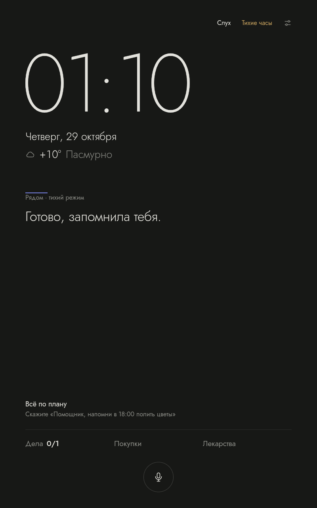
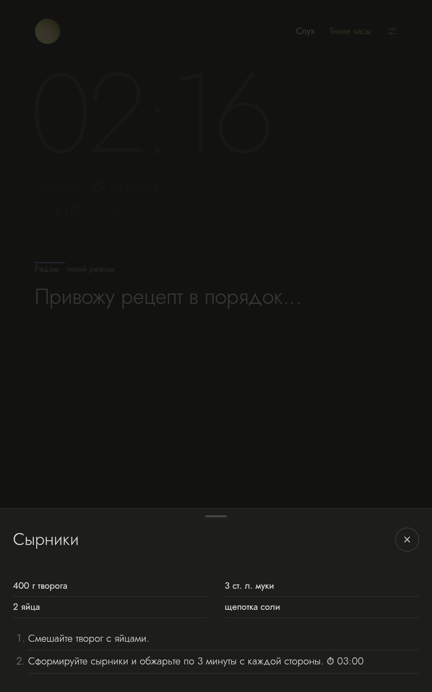
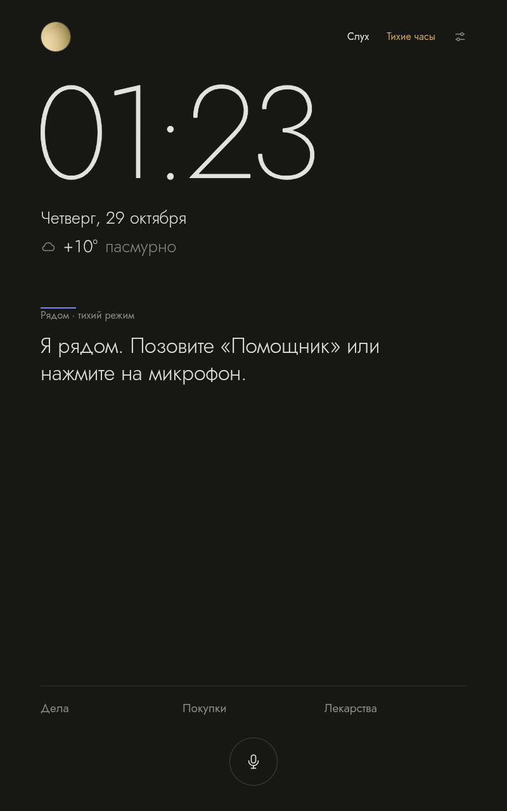

# Функции и голосовые команды

[← К описанию](../../README.ru.md) · [Установка](install.md) · [Настройки](settings.md) · [Приватность](privacy.md) · [Сборка](build.md) · [English](../features.md)

Помощник откликается на своё имя (по умолчанию **«Помощник»**; его можно сменить в настройках). Обращаться можно так:

- **Имя + просьба**: «Помощник, поставь таймер на 5 минут» — сразу выполняет.
- **Только имя**: «Помощник» — пикает и слушает следующую фразу.
- **Кнопка микрофона** внизу экрана — для одной фразы.
- **Продолжение разговора**: 12 секунд после ответа (25 секунд после вопроса помощника) можно говорить без имени: «а завтра?», «нет, в семь».

Значки в таблицах:

| Значок | Значение |
|---|---|
| 🟢 | Работает **без ключа ИИ**, прямо на планшете |
| 🔵 | Нужен ключ Gemini (или запасной мозг) |

Фразы ниже — примеры. Помощник понимает и похожие формулировки.

---

## Экран

| | |
|---|---|
|  |  |
| Днём светлое оформление | После заката тёмное |

- **Верхняя строка**: «Слух» (включить или выключить прослушивание комнаты), «Тихие часы» / «Тихо» (помолчать 1 час), настройки.
- **Часы, дата, погода.** Нажатие на погоду озвучивает прогноз.
- **Сцена**: что помощник услышал и что ответил, с субтитрами по словам.
- **«Сейчас»**: ближайшее лекарство, просроченное или следующее напоминание, подсказка.
- **Виджеты** «Дела», «Покупки», «Лекарства», «Кухня» открывают списки, где можно отмечать и удалять пункты.
- **Кнопки внизу**: «Посмотри» (показать ИИ, что видит камера), микрофон, «Дело» (добавить дело вручную).
- **Окошко камеры** в углу показывает, что камера смотрит. Рамка жёлтая, если рядом только незнакомый человек.
- **Экран покоя**: большие часы и погода, если планшет не трогают 3 минуты. Ночью приглушён, содержимое понемногу сдвигается, чтобы экран не выгорал.
- **Два оформления**: «Минимализм» (по умолчанию, само переключается по восходу и закату) и «Студия» (тёмное, с анимированным «ядром»).
- Нажатие на сцену, пока помощник говорит или звенит, останавливает его.

---

## Время и дата 🟢

| Скажите | Что будет |
|---|---|
| «Который час», «Сколько времени» | Назовёт время |
| «Какое сегодня число», «Какой сегодня день» | Назовёт дату |

---

## Таймеры 🟢

| Скажите | Что будет |
|---|---|
| «Поставь таймер на 5 минут», «Засеки полчаса», «Заведи 30 секунд», «Засеки полтора часа» | Запустит таймер (до 24 часов, можно несколько сразу) |
| «Сколько осталось», «Что с таймером» | Скажет остаток |
| «Отмени таймер», «Сбрось все таймеры» | Остановит |
| «Ещё 5 минут» (когда звенит) | Продлит |
| 🔵 «Поставь таймер на десять минут на пасту» | Таймер с названием |

По окончании звенит до минуты и говорит «Время вышло: …». Чтобы остановить, скажите что угодно или нажмите на экран.

---

## Будильники 🟢

| Скажите | |
|---|---|
| «Разбуди меня в 7» | |
| «Поставь будильник на 6:30 по будням» | |
| «Заведи будильник на завтра в 7 утра» | |
| «Будильник каждый понедельник в 8» | |

Будильник звенит **даже в тихие часы** и даже если рядом никого нет: до 3 минут, с фразой «Доброе утро! Пора вставать. Скажите «стоп» или «ещё 10 минут»».

- **Отложить**: «Ещё 10 минут», «Отложи», «Через 5». Без числа откладывает на 10 минут.
- Если планшет был выключен и время будильника прошло больше чем на 30 минут, он не звенит.

---

## Дела и напоминания

| Скажите | |
|---|---|
| 🟢 «Напомни завтра в 9 позвонить маме» | |
| 🟢 «Напомни через 20 минут выключить духовку» | |
| 🟢 «Не дай мне забыть купить подарок в пятницу» | |
| 🟢 «Напомни каждый день в 8 вечера полить цветы» | |
| 🟢 «Что у меня на завтра», «Какие дела на сегодня» | Прочитает план |
| 🟢 «Не сейчас», «Позже», «Отложи» (после напоминания) | Перенесёт на 30 минут |
| 🔵 «Я всё, позвонила врачу» | Отметит дело выполненным |
| 🔵 «Перенеси врача на четверг», «Удали дело про посылку» | Изменит или удалит |
| 🔵 «Напомни Пете в 5 забрать брата» | Личное напоминание для члена семьи |
| 🔵 «Спланируй мне день» | Составит план |
| 🔵 «До среды допишу главу» | Запишет обещание и в срок спросит, как успехи |

**Как понимается время:** сегодня, завтра, послезавтра, дни недели, «через N минут / час / полчаса», «в 9:30», «к 8 вечера», «утром» (9:00), «днём» (13:00), «вечером» (19:00), «перед сном» (22:00). Повторы: каждый день, по будням, по выходным, каждую среду. «В 8», сказанное после обеда, понимается как 20:00.

**Как напоминает:**

- Вслух, до 3 раз с интервалом 15 минут, но только когда кто-то рядом и не идут тихие часы.
- **Личное напоминание** звучит, только когда помощник видит этого человека. Если рядом есть кто-то ещё, он говорит лишь «у вас личное напоминание, скажите «покажи»».
- При **госте** (рядом только незнакомый человек) напоминания не зачитываются.
- Если дома 10 минут никого нет, напоминание уходит в Telegram (если он подключён).
- Если дело откладывали 3 раза, помощник предложит разбить его на части или отменить.

Добавить дело вручную: кнопка **«Дело»** внизу (текст, время, день, «Повторять каждый день»).

---

## Покупки

| Скажите | |
|---|---|
| 🟢 «Добавь в покупки молоко, хлеб и яйца», «Надо купить сыр», «Купи кофе» | Добавит (дубли пропускаются) |
| 🟢 «Что надо купить», «Прочитай список покупок» | Прочитает |
| 🔵 «Купила молоко», «Очисти купленное» | Отметит или очистит |
| 🔵 «Отправь список на телефон» | Пришлёт в Telegram (или кнопка «На телефон» в списке) |

Купленные продукты сами переносятся в «Кухню», бытовые вещи и лекарства — нет.

---

## Лекарства

| Скажите | |
|---|---|
| 🔵 «Записывай: аспирин по 100 мг каждый день утром после еды» | Добавит курс |
| 🟢 «Выпила аспирин», «Я уже приняла таблетки», «Готово» (после напоминания) | Отметит приём |
| 🟢 «Пропущу», «Сегодня не буду» | Отметит пропуск |
| 🟢 «Позже», «Через полчаса» | Напомнит позже (по умолчанию через 15 минут) |
| 🔵 «Что мне сегодня принимать», «Больше не пью витамин D» | Список на сегодня, отмена курса |

Добавить вручную: вкладка «Лекарства» → **«+ Лекарство»**. Поля: название, доза, время, повтор, до / во время / после еды, для кого, запас таблеток, длительность курса.

- **Напоминание**: «Пора принять аспирин 100 мг, после еды. Скажите «готово», когда примете». До 3 раз через 10 минут.
- **Пропуск**: если приём не отмечен за 30 минут (настраивается), приходит сообщение в Telegram.
- **Запас**: когда таблеток остаётся примерно на 3 дня, лекарство само попадает в покупки.
- **Безопасность**: помощник **никогда не назначает и не меняет дозы**. На вопросы о дозировке, побочных эффектах и совместимости советует обратиться к врачу или фармацевту. При угрозе жизни говорит звонить 112.

---

## Кухня и продукты

| Скажите | |
|---|---|
| 🟢 «Что есть в холодильнике», «Какие у нас продукты» | Прочитает запасы |
| 🟢 «Что скоро испортится», «Что надо съесть в первую очередь» | Сроки годности |
| 🟢 «Закончилось молоко», «Нет больше хлеба» | Уберёт из запасов и добавит в покупки |
| 🔵 «Положила в холодильник курицу, годна до пятницы» | Добавит с местом и сроком |
| 🔵 «Всегда держи дома два литра молока» | Минимальный запас: когда меньше, само добавит в покупки |
| 🔵 «Что приготовить из того, что есть» | Предложит 1–2 блюда, начиная с того, что скоро испортится |
| 🔵 «Посмотри в холодильник» (показать камере) | Перечислит, что видит, и предложит добавить |

Место (холодильник, морозилка, шкаф) помощник угадывает сам, примерный срок годности ставит ИИ. Раз в день, между 9:00 и 20:00, он предупреждает о том, что пора съесть или что уже просрочено.

---

## Рецепты

### Из интернета 🟢

| Скажите | |
|---|---|
| «Найди рецепт борща», «Как приготовить плов», «Давай приготовим сырники» | Найдёт лучший по рейтингу на 1000.menu |
| «Дальше», «Назад», «Повтори», «Какой шаг» | Шаги без рук |
| «Какие ингредиенты» | Прочитает список |
| «На 4 порции», «На двоих» | Пересчитает количество |
| «Другой рецепт», «Не тот» | Покажет другой вариант |
| «Добавь недостающее в покупки» | Чего нет дома — в список покупок |
| «Сохрани» | В книгу рецептов (до 60) |
| «Мои рецепты», «Книга рецептов», «Открой рецепт …» | Сохранённые |

Время на шагах («варите 40 минут») распознаётся само, рядом появляется кнопка таймера. Если на сайте ничего не нашлось, рецепт напишет ИИ 🔵.

### Свои рецепты голосом 🟢

Скажите **«Запиши мой рецепт»**. Помощник по очереди спросит название, ингредиенты, шаги и число порций, прочитает всё обратно и спросит «Сохранить?».

- Во время диктовки: «всё», «убери последнее», «повтори», «пауза», «отмена». Продолжить потом: «продолжим рецепт».
- 🔵 Сразу одной фразой: «Запиши рецепт: …», ИИ сам разобьёт на ингредиенты и шаги.
- Правка открытого рецепта: «добавь шаг …», «убери ингредиент …», «исправь шаг 2: …», «переименуй в …», «удали этот рецепт».

---

## Погода, курсы, новости, вопросы

| Скажите | |
|---|---|
| 🟢 «Какая погода», «Погода завтра», «Что с погодой послезавтра» | Прогноз с советом про зонт (нужен город в настройках) |
| 🟢 «Курс евро», «Сколько стоит доллар в злотых» | Курс НБП (для злотого) или open.er-api |
| 🔵 «Что нового в новостях», «Кто такой …», любые вопросы | Поиск Google через Gemini, если недоступен — новости Google и Википедия |
| 🔵 «Сколько будет 17 на 23», «Как по-английски …» | Отвечает ИИ |

Валюты: EUR, USD, PLN, RUB, UAH, GBP, CHF, CZK, BYN, KZT, JPY, CNY, TRY.

---

## Радио

| Скажите | |
|---|---|
| 🟢 «Включи музыку», «Включи радио» | Последний жанр или русская поп-музыка |
| 🟢 «Громче», «Тише», «Другая станция», «Выключи музыку» | Управление |
| 🔵 «Включи джаз», «Включи что-нибудь спокойное», «Радио Рекорд» | По жанру или станции |

Станции берутся из открытого каталога Radio Browser. Пока помощник слушает или говорит, музыка становится тише. **Отдельные песни и исполнителей он не включает**, только радио.

---

## Семья и узнавание лиц

| Скажите | |
|---|---|
| 🟢 «Давай познакомимся», «Запомни меня», «Познакомься с моим сыном Петей» | Знакомство |
| 🟢 «Забудь меня» | Удалит человека (после подтверждения) |

- Лица распознаются **на самом планшете**, в интернет не уходят.
- Со знакомым человеком здоровается раз в день: «Добрый день, Маша! У вас сегодня 2 дела».
- Учитывает обращение на «ты» или «вы», возраст (с детьми говорит проще) и настроение по выражению лица.
- **Режим гостя.** Когда рядом только незнакомый человек, помощник:
  - не зачитывает дела, лекарства и утренний план;
  - не рассказывает о семье;
  - не даёт удалять дела, очищать списки и стирать память;
  - скрывает личное в списках.

Управление семьёй: Настройки → «Семья» (переснять лицо, удалить, познакомиться).

---

## Память 🔵

| Скажите | |
|---|---|
| «Запомни: я пью кофе без сахара» | Сохранит факт (до 80) |
| «Забудь про кофе» | Удалит |

Пароли, номера карт и документов помощник **не запоминает**. Список фактов можно посмотреть и почистить в настройках, раздел «Память».

---

## Сам по себе 🔵

- **Утренний план**: первому, кто подойдёт между 6:00 и 12:00, раз в день, в 2–3 фразах расскажет план и погоду.
- **Подсказки по камере**: заговаривает сам, только если это полезно (готовка, опасность, кто-то уходит). Частота зависит от «Разговорчивости»: тихий режим — не чаще раза в 60 минут, обычный — в 20, активный — в 7.
- **Тихие часы** и «Помолчи» (1 час): сам не заговаривает, но будильники звенят.

---

## Экстренная помощь (SOS) 🟢

Работает **всегда, даже без имени**: «Помогите», «На помощь», «Мне плохо», «Вызови скорую», «Я упал», «Не могу встать», «Задыхаюсь», «Сердце болит».

- **Telegram подключён**: помощник останавливает радио и звуки и говорит «Сейчас отправлю сигнал тревоги на телефон. Скажите «отмена», если всё в порядке». Через 20 секунд на телефон уходит 🆘 с услышанной фразой и последним наблюдением камеры. Отмена: «отмена», «всё хорошо», «случайно».
- **Telegram не подключён**: «Если нужна скорая — звоните 112».

> Помощник **не звонит** в экстренные службы сам. Это не замена тревожной кнопке или медицинскому браслету.

---

## Связь с телефоном (Telegram)

Настройка описана в [install.md](install.md#10-связь-с-телефоном-через-telegram-по-желанию).

| Напишите боту | Ответ |
|---|---|
| 🟢 `список`, `покупки` | Список покупок |
| 🟢 `дела`, `план` | Дела на сегодня и завтра |
| 🟢 `лекарства`, `таблетки` | Приёмы на сегодня |
| 🔵 Любой текст: «добавь молоко», «напомни в 19:00 забрать посылку» | Выполнит, ответ придёт в чат, дома при этом молчит |

Помощник сам присылает: список покупок (по просьбе), напоминания, когда дома никого нет, пропущенные лекарства и сигнал SOS.

---

## Управление голосом и речью 🟢

| Скажите | |
|---|---|
| «Стоп», «Хватит», «Подожди», «Понятно» | Замолчит |
| «Помолчи», «Не мешай» | Помолчит 1 час |
| «Подробнее», «Да» / «Нет, спасибо» | Продолжить или прервать длинный ответ (длинные ответы он сокращает и спрашивает «Рассказать подробнее?») |
| «Смени голос», «Другой голос» → «Оставь» | Выбор голоса планшета |
| «Проверь себя», «Покажи последнюю проверку» | Самопроверка |

**Голос.** «Живой голос Gemini» (6 тембров, женские и мужские). Если его лимит кончился, звучит голос планшета. Помощник говорит о себе в роде, соответствующем голосу («записала» / «записал»).

**Паузы.** Если вы задумались посреди фразы («напомни завтра в… э-э… девять»), он дождётся окончания.

---

## Что работает без ключа ИИ

Таймеры, будильники, напоминания (простые фразы), дела на сегодня и завтра, список покупок, погода, курсы валют, поиск рецептов на 1000.menu и диктовка своих, кухня (что есть, что испортится, что закончилось), отметка лекарств, радио по фиксированным фразам, SOS, команды Telegram, самопроверка (кроме сетевых пунктов ИИ).

На остальное помощник ответит «Сначала добавьте ключ Gemini в настройках». Если кончился дневной лимит: «Без ИИ я всё равно умею: таймеры, будильники, напоминания, покупки, дела и погоду».

---

## Чего помощник не умеет

- Включать конкретные песни и видео.
- Звонить.
- Управлять светом и техникой.
- Заказывать товары.
- Писать кому-то, кроме привязанного телефона.

Он честно говорит об этом и, если получится, предлагает замену (например, радио).

---

## Надёжность

- Сам перезапускается после сбоя и запускается при включении планшета ([как включить](install.md#9-автозапуск-и-перезапуск-после-сбоя)).
- Если страница зависла на 90 секунд, приложение перезагружает её.
- Ночью в 4:00, если всё спокойно, страница тихо перезагружается.
- **Самопроверка**: 32 проверки (навыки, кухня, лекарства, рецепты, сеть, камера, микрофон, голос, экран) на тестовых данных. Ваши данные не меняются. Запускается по команде «Проверь себя» и сама после каждого обновления.
