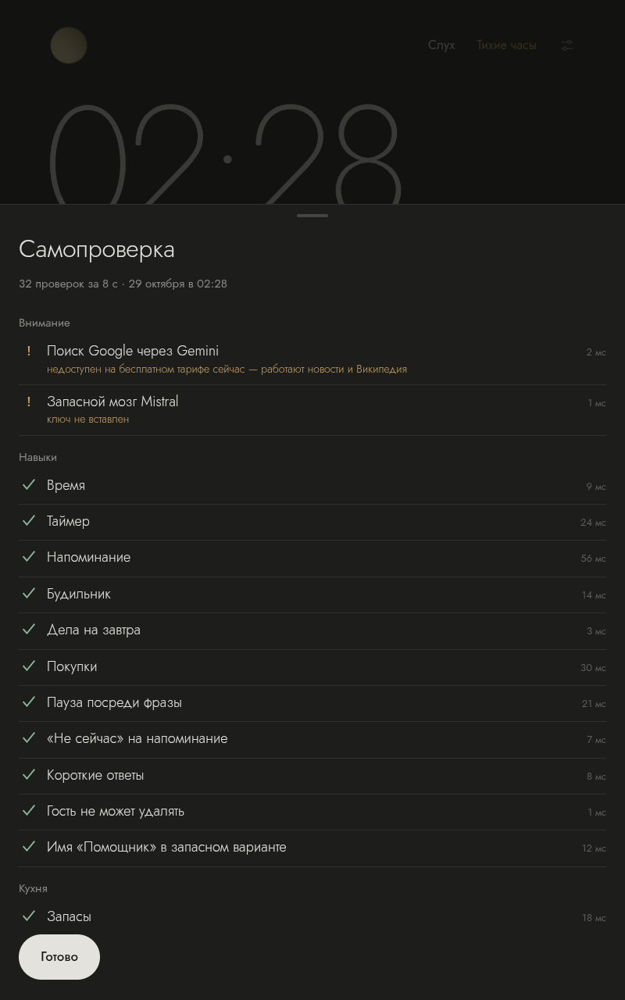

# Установка и первый запуск

[← К описанию](../../README.ru.md) · [Функции](features.md) · [Настройки](settings.md) · [Приватность](privacy.md) · [Сборка](build.md) · [English](../install.md)

---

## 1. Что нужно

| | Требование |
|---|---|
| Устройство | Планшет или телефон на **Android 8.0 и новее**. Разработано и проверено на Lenovo Tab M10 HD (Android 11) |
| Камера | Фронтальная. Без неё приложение работает, но не узнаёт людей, не видит, есть ли кто-то рядом, и не подсказывает по камере |
| Микрофон | Обязателен для голосового управления |
| Распознавание речи | Сервис распознавания Google на устройстве (обычно уже есть) |
| Голос | Русский голос синтеза речи на устройстве (Настройки → Специальные возможности → Синтез речи) |
| Интернет | Wi-Fi. Без интернета работают только таймеры, будильники, напоминания и списки |
| Ключ ИИ | Бесплатный ключ Google Gemini. Без него помощник умеет только базовые команды ([что именно](features.md#что-работает-без-ключа-ии)) |

Место: около 15 МБ под приложение плюс данные.

---

## 2. Скачать APK

Откройте на планшете страницу **Releases** этого репозитория и скачайте файл `Pomoshnik-1.0-release.apk`.

Можно скачать на компьютер и перекинуть на планшет по USB-кабелю.

---

## 3. Разрешить установку из файла

Android по умолчанию не ставит приложения не из Google Play. Разрешение даётся одному приложению, через которое вы открываете APK (браузер или «Файлы»).

1. Откройте скачанный файл `Pomoshnik-1.0-release.apk`.
2. Android покажет «В целях безопасности на устройстве заблокирована установка…». Нажмите **Настройки**.
3. Включите **Разрешить установку из этого источника**.
4. Вернитесь назад кнопкой «Назад».

Тот же пункт есть в меню: **Настройки → Приложения → Специальный доступ → Установка неизвестных приложений**. Названия пунктов могут немного отличаться у разных производителей.

> После установки это разрешение можно выключить обратно.

---

## 4. Установить

1. Нажмите **Установить**.
2. Если появится Google Play Защита с вопросом о незнакомом приложении, нажмите **Подробнее → Всё равно установить**. Приложение не из Play Маркета, поэтому Защита его не знает.
3. Дождитесь «Приложение установлено» и нажмите **Открыть**.

### Установка с компьютера (для опытных)

Если включена отладка по USB или по Wi-Fi:

```
adb install Pomoshnik-1.0-release.apk
```

### Если установка не проходит

| Сообщение | Что делать |
|---|---|
| «Приложение не установлено» / «конфликт с существующим пакетом» | На устройстве уже стоит другая сборка «Помощника» с другой подписью. Удалите её (**данные старой версии удалятся**) и установите снова |
| «Синтаксическая ошибка при анализе пакета» | Файл скачался не полностью или Android старше 8.0. Скачайте заново |
| Кнопка «Установить» не нажимается | Закройте плавающие окна и кнопки поверх экрана (фильтр синего, чат-головы) и повторите |

---

## 5. Первый запуск

1. Откройте «Помощник». Приложение разворачивается на весь экран.
2. Android попросит доступ к **камере** и **микрофону**. Разрешите оба: «При использовании приложения».
3. Помощник скажет, что нужен ключ, и откроет настройки.


---

## 6. Получить бесплатный ключ Gemini

Ключ — это строка, по которой Google узнаёт ваш доступ к ИИ. Он бесплатный, банковская карта не нужна.

1. На компьютере или телефоне откройте **aistudio.google.com** и войдите в Google-аккаунт.
2. Нажмите **Get API key → Create API key**. Если предложат выбрать проект, выберите **Create API key in new project**.
3. Скопируйте ключ (начинается с `AIza…`).
4. На планшете: значок настроек в правом верхнем углу → поле **«Ключ Gemini API»** → вставьте ключ → **Сохранить**.

Ключ хранится **только на этом планшете**. Его нет ни в APK, ни в репозитории.

> Если ИИ отвечает «Ключ не подходит», проверьте, что скопировали его целиком, без пробелов. Если пишет, что API не включён, создайте ключ в **новом** проекте.

### Запасной мозг (по желанию)

У бесплатного Gemini есть дневной лимит. Чтобы помощник не замолкал, когда лимит кончится, добавьте второй бесплатный ключ:

| Поставщик | Где взять | Карта |
|---|---|---|
| Groq | console.groq.com → API Keys | не нужна |
| OpenRouter | openrouter.ai → Keys | не нужна (50 бесплатных запросов в день) |
| Mistral | console.mistral.ai → API Keys | нужен платный тариф |

В настройках выберите поставщика в **«Запасной мозг»** и вставьте ключ в **«Ключ запасного мозга»**.

---

## 7. Обязательные настройки

Подробно каждая настройка описана в [settings.md](settings.md). Минимум, который стоит задать сразу:

1. **Ваш город**: нужен для погоды, утреннего плана и смены светлой и тёмной темы.
2. **Имя помощника**: на это слово он откликается. По умолчанию «Помощник».
3. **Тихие часы**: когда помощник сам не заговаривает. По умолчанию 22:00–08:00.

Нажмите **Сохранить**.

---

## 8. Познакомить помощника с семьёй

Чтобы помощник узнавал людей, здоровался по имени и выдавал личные напоминания только нужному человеку:

1. Встаньте перед планшетом и скажите: **«Помощник, давай познакомимся»** (или кнопка **«Познакомиться»** в настройках, раздел «Семья»).
2. Ответьте на вопросы: имя, кем приходитесь в семье, на «ты» или на «вы», возраст (можно пропустить).
3. Согласитесь сохранить лицо. Помощник попросит чуть повернуть голову влево и вправо и сделает до 6 снимков.

Снимки лица **не уходят в интернет**: на планшете хранятся только числовые «отпечатки» лица и маленькая аватарка. Повторите для каждого члена семьи.

---

## 9. Автозапуск и перезапуск после сбоя

Помощник рассчитан на то, чтобы планшет постоянно стоял включённым. Чтобы он сам запускался после перезагрузки или сбоя:

1. В настройках помощника включите **«Запускаться при включении планшета»** (по умолчанию включено).
2. Если под переключателем написано «Нужно разрешение «Поверх других приложений»», откройте **Настройки Android → Приложения → Специальный доступ → Поверх других приложений → Помощник** и включите разрешение. Без него Android не даёт приложению открыться самому.
3. Проверьте: перезагрузите планшет. Помощник должен открыться сам.

Совет: держите планшет на зарядке. Экран у помощника не гаснет, пока приложение открыто.

Если планшет всё равно закрывает приложение в фоне, отключите для «Помощника» оптимизацию батареи: **Настройки → Приложения → Помощник → Батарея → Без ограничений**. Пункт есть не на всех устройствах.

---

## 10. Связь с телефоном через Telegram (по желанию)

Через Telegram помощник присылает список покупок, напоминания (когда дома никого нет), сигнал SOS и пропущенные лекарства. С телефона ему можно писать.

1. В Telegram откройте **@BotFather** → `/newbot` → придумайте имя и логин бота → скопируйте **токен**.
2. В настройках помощника вставьте токен в **«Токен бота от @BotFather»** → **Сохранить**.
3. Нажмите **«Привязать»** и в течение 2 минут напишите своему боту с телефона (например, `/start`).
4. Статус станет «Подключено — пишите боту с телефона».

Привязывается первый чат, который напишет боту. Остальным бот отвечает «Это личный домашний помощник». Команды с телефона описаны в [features.md](features.md#связь-с-телефоном-telegram).

---

## 11. Проверить, что всё работает

Скажите: **«Помощник, проверь себя»**. За минуту он пройдёт 32 проверки и покажет отчёт. Ваши дела и данные при этом не меняются.



Жёлтые пункты («Внимание») не страшны. Обычно это значит, что не вставлен запасной ключ или поиск Google временно недоступен на бесплатном тарифе.

После каждой установки новой версии самопроверка запускается сама примерно через 1,5 минуты.

---

## 12. Обновление

Новую версию ставьте поверх старой, так же, как при первой установке. Данные сохранятся, если APK подписан **тем же ключом**, что и установленный.

Если Android пишет о конфликте, значит, подпись другая. Тогда придётся удалить старую версию, и данные пропадут.

---

## 13. Удаление

**Настройки → Приложения → Помощник → Удалить.**

Вместе с приложением удаляются все его данные: ключи, семья, лица, дела, лекарства, рецепты. Резервная копия Android их не сохраняет (это отключено специально).

---

## Частые проблемы

| Проблема | Решение |
|---|---|
| Не откликается на имя | Проверьте, что включён «Слух» (вверху экрана) и не идут «Тихие часы». Говорите имя чётко в начале фразы. Можно нажать на микрофон внизу |
| «Сначала добавьте ключ Gemini» | Ключ не вставлен или не сохранён (раздел 6) |
| «Бесплатный лимит Google на сегодня исчерпан» | Дневной лимит кончился. Добавьте запасной мозг. Таймеры, будильники, напоминания, покупки и погода работают и без ИИ |
| Нет погоды | Не задан город в настройках |
| Говорит роботом | Выключен «Живой голос Gemini» или кончился его лимит. Тогда звучит голос планшета. Другой голос: «Помощник, смени голос» |
| Не узнаёт человека | В настройках, раздел «Семья», нажмите «Лицо» у этого человека, чтобы снять лицо заново при хорошем свете |
| Не запускается после перезагрузки | Раздел 9: разрешение «Поверх других приложений» |
| Завис экран | Приложение само перезагрузит страницу примерно через 90 секунд |
